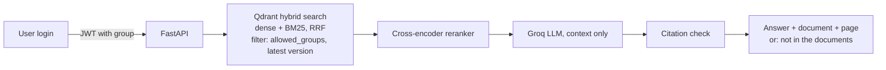

# Health Insurance Policy RAG

[](https://github.com/thimmareddygt7/RAG_BASE_INSURANCE/actions/workflows/ci.yml)

Ask plain-English questions about health insurance policy documents and get answers with a **document name and page number**, or a clear "not in the documents" when the answer is missing. The project focuses on the hard parts of real-world RAG: messy PDFs, access control, citation checking, versioned documents and honest measurement.

> **Demo only, not insurance advice.** This is a technical demonstration. It does not provide medical, legal or insurance advice. Check official policy documents with a licensed representative.

## Status (read this first)

- **Implemented and unit-tested:** the full pipeline (parsing, layout chunking, hybrid search, reranking, citation verification, refusal calibration, role-based access control, incremental indexing, versions, evaluation harness, FastAPI backend, Streamlit UI). The unit tests run offline with deterministic stand-ins for the models.
- **The corpus is synthetic.** The four PDFs (19 pages) are generated by `scripts/generate_sample_pdfs.py` for fictional insurers. Nothing comes from a real insurer.
- **No accuracy numbers are reported yet.** The first five-stage run was archived in `eval/results/archive_unverified/` because it did not record which model answered each question (the client could silently switch models on a rate limit), cached answer replies were counted in the latency, and refusal thresholds were fitted on only 2 unanswerable questions. Those problems are fixed; rerun the stages to get numbers you can cite. [`docs/results.md`](docs/results.md) explains how.
- **The 100-question gold set is `drafted`, not verified.** Rows become `verified` only after `scripts/check_gold_evidence.py` confirms the evidence is on the stated page. The judge has not been audited by a person yet (`scripts/audit_sample.py`).

## Try it in two minutes, no API key

```bash
pip install pyyaml
python scripts/demo_offline.py
```
This asks the same questions as a policyholder, an agent and an admin against a synthetic two-version policy and a fake agent guide. The policyholder is refused the agent-only answer, and the agent gets it with a citation. It uses stand-in components, so it demonstrates access control and citations, not language-model quality.

## What makes this project different

- **Permissions inside the search query.** The user's group comes from a signed token, never the request body. The filter runs in the vector store, so restricted text never reaches the reranker, the prompt or the answer. 8 permission cases (canary string, prompt injection, forged group) pass with 0 leaks on the synthetic corpus, and a sabotage test proves the leak detector can fail.
- **Citations are checked, not trusted.** Every `[DOC_ID p.N]` marker is verified against the page text the model saw: the page must have been retrieved, every number in the claim must appear on it, and enough content words must match.
- **Refuses instead of guessing.** A calibrated score threshold and the model's own refusal both lead to "not in the documents".
- **Honest measurement.** One change per stage with the models and question set locked, counts with 95% confidence intervals, exact McNemar tests between stages, and a refusal threshold calibrated on a separate split.
- **Incremental indexing and versions.** Files are hashed, unchanged ones skipped, and changed ones replace only their own chunks. A config change reindexes automatically. Old policy versions are hidden by default and searchable on request.
- **Reproducible and tidy.** One `docker compose up`, SHA-256-verified document downloads, no documents in git, CI, secret scanning, non-root containers.

## Architecture



More in [`docs/architecture.md`](docs/architecture.md), with the reasoning for each choice in [`docs/decisions.md`](docs/decisions.md).

## The five measured stages

| Stage | Change |
|---|---|
| 2 | Vector search, fixed-size chunks (baseline) |
| 3 | Add BM25 sparse search fused with RRF |
| 4 | Add cross-encoder reranker |
| 5 | Section-aware chunking: tables whole, title and heading prepended |
| 6 | OCR for scanned pages, PDF tables, header and footer cleanup, column order |

Select a stage with `RAG_STAGE=stage4_rerank`. Details in [`docs/evaluation_plan.md`](docs/evaluation_plan.md).

## Stack

| Layer | Choice |
|---|---|
| API | Python 3.11, FastAPI, JWT (PyJWT), stdlib scrypt |
| LLM and judge | Groq, `openai/gpt-oss-20b` (fixed; no silent fallback, see `llm.allow_fallback`) |
| Embeddings | `BAAI/bge-small-en-v1.5` (384 dimensions, CPU) |
| Vector store | Qdrant `v1.12.5`, dense and sparse vectors in one collection |
| Reranker | `cross-encoder/ms-marco-MiniLM-L-6-v2` |
| Parsing | PyMuPDF (text, tables, page rendering), Tesseract OCR |
| UI | Streamlit |
| Tooling | Docker Compose, pytest, ruff, GitHub Actions, pre-commit with gitleaks |

## Quickstart (real models)

```bash
cp .env.example .env                 # add your Groq key and a random AUTH_SECRET_KEY
docker compose up -d qdrant          # Qdrant (the API and UI also start with `docker compose up`)
python scripts/generate_sample_pdfs.py                 # writes the fictional PDFs to data/raw/
python scripts/check_gold_evidence.py --write-verified --ocr   # confirm evidence is on the stated pages
python scripts/run_eval_all.py                         # five stages, with integrity checks
python scripts/audit_sample.py create --stage stage4_rerank    # then fill in the CSV yourself
```
Read the "Run integrity" table in `eval/results/REPORT.md` before trusting any number. A harder companion benchmark is `data/gold/gold_questions_blind.csv` (run it with `--gold data/gold/gold_questions_blind.csv --tag blind`).
Without Docker: `pip install -r requirements-dev.txt`, then `make test`, `make lint`, `make validate-gold`.

## API

| Endpoint | Who | Purpose |
|---|---|---|
| `GET /health` | anyone | Liveness and mode |
| `POST /auth/login` | anyone | Returns a signed token (demo users: alice, bob, carol) |
| `GET /documents` | signed in | Documents visible to your group |
| `POST /ask` | signed in | Answer with citations and sources |
| `POST /admin/reindex` | admin | Incremental reindex |

## Repository layout

```
app/        config, auth, API, pipeline, ingest/, search/, store/, answer/
eval/       metrics, judge, runner, report, calibration, permission tests, stages.yaml
scripts/    generate_sample_pdfs, check_gold_evidence, build_blind_gold, audit_sample, run_eval_all,
            validate_gold, download, sync_index, demo_offline, make_demo_users
data/       gold/ (questions, blind questions, sources, permission tests), synthetic/ (offline demo)
docs/       architecture, evaluation plan, data rules, decisions, results, runbook, demo script
tests/      unit tests 
ui/         Streamlit app
```

## Data and legal

Only public documents are used and none are committed. `scripts/download.py` rebuilds the corpus from source links and skips any document whose license has not been checked. See [`docs/data.md`](docs/data.md).

## Limitations

- The benchmark has about a hundred questions, so gaps of a few points are noise. Reports show confidence intervals for this reason.
- Answer and judge use the same model, which can bias scoring. Audit a sample by hand (`scripts/audit_sample.py`) and report the agreement with its confidence interval.
- The main gold set names the product and version in almost every question, so retrieval looks easy. The blind set removes those hints.
- The refusal threshold is only fitted when the calibration split has at least 5 answerable and 5 unanswerable questions. Otherwise the model's own refusal is used.
- The corpus is four generated documents, so results say little about real insurer PDFs.
- Table extraction from PDFs depends on PyMuPDF and may fail on complex layouts. Test it on your documents first.
- Demo accounts only. A real deployment needs a user database, rate limiting and audit logs.
- Hosted model names can be retired. Recheck `config.yaml` before reruns.
- English-language documents only.

## License

MIT. See [`LICENSE`](LICENSE) and [`SECURITY.md`](SECURITY.md).
