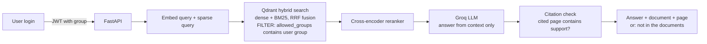
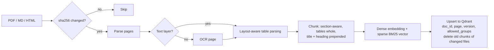

# Architecture

## Query path

## Ingestion path

## Key design rules

1. **Permissions are enforced inside the vector query.** The group comes from the signed token, never from the request body. Filtering after retrieval would leak restricted text into the reranker and the prompt.
2. **One collection holds dense and sparse vectors**, so hybrid search and the permission filter run in a single Qdrant query.
3. **Models are fixed across stages** (see `eval/stages.yaml`), so measured differences come from the pipeline change and not from a different model.
4. **Every chunk keeps `doc_id`, `page` and `version`**, which makes page-level evaluation and citation checking possible.
